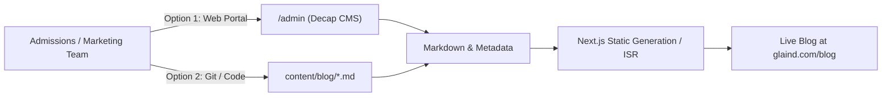

# The Global Language Academy (TGLA) — Official Client Handover Document & Operational SOP

---

## 1. Executive Summary & Quick Reference

This document serves as the official operational handover for **The Global Language Academy (TGLA)** web platform (`glaind.com`). It contains all production assets, source code repositories, lead generation integrations, blogging workflows (SOP), and system maintenance guidelines for both the client's internal management team and technical administrators.

### Core Assets & Repositories

| Item | Details |
| :--- | :--- |
| **Website Platform** | The Global Language Academy (TGLA) |
| **Production URL** | `https://glaind.com` |
| **Source Code Repository** | [GitHub: dharuv-20/GLA-](https://github.com/dharuv-20/GLA-.git) |
| **Production Branch** | `main` |
| **Primary Technology** | Next.js 16 (App Router), React 19, TypeScript, Tailwind CSS |
| **Content Management** | Decap CMS (Git-based Markdown) + Supabase-ready architecture |
| **Form Backend & CRM** | Google Forms & Google Sheets Cloud Integrations |
| **Handover Date** | November 2026 |

---

## 2. Lead Generation & Contact Infrastructure

All lead generation across the website is integrated into individual, secure Google Forms that automatically populate dedicated Google Sheets for real-time tracking by admissions counsellors.

### 2.1 Google Form Response Endpoints & Connected Sheets

| Course / Page | Google Form Link | Purpose |
| :--- | :--- | :--- |
| **Home & About (Common Lead Form)** | [GLA Lead Common Form](https://docs.google.com/forms/d/e/1FAIpQLScrKYxkYDW45bm2UX7l-hFzyKEt5CU4jw8o9pfH4IXauHsivg/viewform?usp=dialog) | Captures general enquiries, diagnostic test requests, and homepage consultations. |
| **German Language** | [German Course Form](https://docs.google.com/forms/d/e/1FAIpQLSduzH2xHvNWRNFM_L5xKQJd4Obot1b6xt8zi61FJmTXucq01w/viewform?usp=publish-editor) | Goethe/ÖSD A1-C2 preparation and Ausbildung counselling leads. |
| **French Language** | [French Course Form](https://docs.google.com/forms/d/e/1FAIpQLSck42kMHxcCpSB_ZwevAIWDoioNKZZ4l04uUDsePd8yW_3kBA/viewform?usp=publish-editor) | DELF/DALF, TEF/TCF Canada immigration exam prep leads. |
| **Japanese Language** | [Japanese Course Form](https://docs.google.com/forms/d/e/1FAIpQLSe4mXaG6DKsWXACFYwn4XUipGhIbLyTvYEkcH-InRR_PBdieg/viewform?usp=publish-editor) | JLPT N5-N1 certification, SSW visa, and Japanese corporate training. |
| **PTE Academic** | [PTE Academic Form](https://docs.google.com/forms/d/e/1FAIpQLSdGSt7guoIuphk0N1abNnM4eiwp-FE0bzIx-OU6KqFL_NxiYA/viewform?usp=publish-editor) | Fast-track AI-scored mock evaluation and PTE 79+ masterclass leads. |
| **IELTS Masterclass** | [IELTS Masterclass Form](https://docs.google.com/forms/d/e/1FAIpQLSfZYq_bBn-gpB0IsSQmaxu6DxGKv6WlA2Fa-Uh4uOmylsdzrQ/viewform?usp=publish-editor) | Academic/General Band 8+ preparation and diagnostic scoring leads. |
| **Spoken English & Fluency** | [Spoken English Form](https://docs.google.com/forms/d/e/1FAIpQLScuekDkmG5-kl2Ck36IpFhFfXrzfCd4Wzc_kFXzTdKSwmEjlQ/viewform?usp=publish-editor) | Public speaking, professional corporate fluency, and accent coaching leads. |

> [!TIP]
> **Admissions Team Best Practice**: Inside each Google Form, click on the **Responses** tab and enable **"Get email notifications for new responses"** so your front desk receives an instant email alert every time a student submits an enquiry.

### 2.2 Official Academy Contact Details (Site-wide Standard)

The contact numbers must follow this exact order across all marketing and website copy:
1. **Landline (Admissions Desk):** `011 4058 3726`
2. **Primary WhatsApp / Counsellor Helpline:** `+91 92179 99511`
3. **Secondary WhatsApp / Student Helpline:** `+91 92176 69511`
4. **Official Email:** `care@glaind.com`

### 2.3 Physical Campuses & Directions

- **Sector 12 Training Center:**
  - *Address:* Second Floor, Plot No 20, Rd Number 203, Parmanand Colony, Pocket 8, Block B, Near City Centre, Sector 12 Dwarka, New Delhi 110078
  - *Google Maps Link:* [View on Google Maps](https://maps.app.goo.gl/MjoAJesxjva2uNEX8?g_st=ic)
- **Sector 13 Registered Corporate Office:**
  - *Address:* 3rd Floor, Plot No 94, PKT-10, Dwarka Sector 13 (Opp. Metro Station, Near Radisson Blu Hotel), New Delhi 110078

---

## 3. Standard Operating Procedure (SOP): Blog Management

The website includes a high-performance, SEO-optimized blog engine designed for instant search engine indexing. Articles are rendered server-side with structured Schema.org markup.



### 3.1 Method 1: Publishing via the Web CMS Admin Portal

This is the easiest method for non-technical content writers and marketing executives.

1. Navigate to `https://glaind.com/admin/` in your web browser.
2. Sign in using your authorized GitHub or Netlify Identity credentials.
3. In the sidebar, select **Blog Posts**.
4. Click **New Blog Post**.
5. Fill in the required metadata fields:
   - **Title**: Compelling, keyword-rich headline (e.g., *"How to Score Band 8.0 in IELTS in 30 Days"*).
   - **Publish Date**: Select current or scheduled date.
   - **Author**: e.g., *"TGLA Academic Team"* or trainer name (e.g., *"Ms. Hardika"*).
   - **Category**: Select from dropdown: `German`, `French`, `Japanese`, `IELTS`, `PTE`, `Spoken English`, or `Study Abroad`.
   - **Cover Image**: Upload a high-resolution WebP or JPG banner (recommended: 1200x630px).
   - **Excerpt**: 1-2 sentence meta description for Google search snippets (150-160 characters).
   - **Body**: Write your article using the rich markdown editor (headings, bullet points, images, quotes).
6. Click **Save** > **Publish** > **Publish Now**.
7. The platform will automatically compile the page and display it on `glaind.com/blog` within minutes.

---

### 3.2 Method 2: Creating Blog Posts Directly in Source Code

Developers or technical staff can push articles directly via Git:

1. Open the repository and navigate to: `content/blog/`.
2. Create a new markdown file following kebab-case naming:
   `content/blog/how-to-prepare-for-goethe-b1-exam.md`
3. Add the required Frontmatter header at the top of the file:
   ```markdown
   ---
   title: "How to Prepare for Goethe-Zertifikat B1 Exam"
   date: "2026-11-04"
   author: "TGLA German Faculty"
   category: "German"
   excerpt: "Master the 4 modules of Goethe B1 German exam with our structured study plan, exam strategies, and model test papers."
   image: "/images/blog/goethe-b1-guide.webp"
   featured: true
   readTime: "6 min read"
   ---

   ## Introduction

   Write the article contents here using standard markdown syntax.

   ### Key Exam Sections
   - **Lesen (Reading):** 65 minutes
   - **Hören (Listening):** 40 minutes
   - **Schreiben (Writing):** 60 minutes
   - **Sprechen (Speaking):** 15 minutes
   ```
4. Place your article cover image in `public/images/blog/`.
5. Commit and push your changes to GitHub:
   ```bash
   git add content/blog/how-to-prepare-for-goethe-b1-exam.md public/images/blog/
   git commit -m "feat(blog): publish Goethe B1 preparation guide"
   git push origin main
   ```

---

## 4. Technical Architecture & Codebase Navigation

The application uses the modern **Next.js 16 App Router** with React 19.

### Directory Structure & File Map

```text
GLA/
├── content/
│   └── blog/                       # All published blog articles (.md format)
├── public/
│   ├── admin/                      # Decap CMS configuration (config.yml, index.html)
│   ├── images/
│   │   ├── assets/                 # Brand logos, metro pin graphics, badges
│   │   ├── courses/                # Country landmark course cover images
│   │   └── blog/                   # Blog article banner assets
├── src/
│   ├── app/
│   │   ├── layout.tsx              # Root HTML wrapper, global fonts & SEO metadata
│   │   ├── page.tsx                # High-converting Homepage
│   │   ├── about/page.tsx          # About Us & leadership credentials
│   │   ├── contact/page.tsx        # Contact Us, maps embed, consultation booking
│   │   ├── services/page.tsx       # Comprehensive institutional services overview
│   │   ├── courses/[slug]/         # Individual course master pages:
│   │   │   ├── GermanCourseView.tsx
│   │   │   ├── FrenchCourseView.tsx
│   │   │   ├── JapaneseCourseView.tsx
│   │   │   ├── IeltsCourseView.tsx
│   │   │   ├── PteCourseView.tsx
│   │   │   └── SpokenEnglishCourseView.tsx
│   │   ├── blog/                   # Blog index & individual article dynamic viewer
│   │   ├── thank-you/              # Conversion landing page after lead submission
│   │   ├── sitemap.ts              # Automated XML sitemap generator for Googlebot
│   │   └── robots.ts               # Search crawler indexing directives
│   ├── components/
│   │   ├── layout/
│   │   │   ├── Header.tsx          # Desktop & Mobile Navigation with phone CTAs
│   │   │   ├── Footer.tsx          # Global Footer with phone, address, and legal links
│   │   │   └── FloatingWhatsApp.tsx# Sticky quick-contact floating widget
│   │   ├── FacultyCard.tsx         # Academic Faculty badge cards
│   │   └── LeadFormModal.tsx       # Universal lead generation dialog modal
│   └── data/
│       ├── courses-db.ts           # Central database of course pricing, batches & faculty
│       ├── home-faqs.ts            # Homepage FAQs and answers
│       └── services-db.ts          # Corporate training & immigration services data
├── next.config.ts                  # Next.js build and optimization settings
├── tailwind.config.ts              # Custom brand color scheme (Royal Navy, Gold, Purple)
└── package.json                    # Dependencies & operational scripts
```

---

## 5. Developer Setup & Local Environment Runbook

For any developer continuing technical development or updates on this project:

### Prerequisites
- **Node.js**: v18.18.0 or v20.x+ (Node 20 LTS recommended)
- **npm**: v9.x or higher
- **Git**

### Installation & Local Run Steps

1. **Clone the Repository:**
   ```bash
   git clone https://github.com/dharuv-20/GLA-.git
   cd GLA
   ```

2. **Install Project Dependencies:**
   ```bash
   npm install
   ```

3. **Launch the Local Development Server:**
   ```bash
   npm run dev
   ```
   Open your browser and visit: `http://localhost:3000`

4. **Verify Production Compilation:**
   ```bash
   npm run build
   npm run start
   ```

---

## 6. Deployment Guides

### Option A: Current Netlify Setup (Continuous Integration)
- The GitHub repository `dharuv-20/GLA-` is connected to Netlify.
- Every commit pushed to the `main` branch triggers an automated build (`next build`) and deploys the changes within 60–90 seconds.

### Option B: Hostinger Business Web Hosting Setup (Recommended)
If migrating hosting to Hostinger's **Business / Unlimited Plan ($3.49/mo)**:

1. **Access hPanel**: Log into your Hostinger Dashboard and open **Advanced > Node.js**.
2. **Create Application**:
   - **Node.js Version**: Select `Node.js 20.x LTS` or `22.x LTS`.
   - **Application Root**: `/home/uXXXXX/public_html` (or desired directory).
   - **Application Startup File**: `server.js` (with Next.js standalone mode).
3. **Connect Git Repository**:
   - In hPanel, go to **Git Repository** and paste `https://github.com/dharuv-20/GLA-.git`.
   - Set Branch to `main`.
4. **Deploy Command**:
   ```bash
   npm install && npm run build
   ```
5. **SSL Certificate**: Click **Security > SSL** in hPanel and enable the free Lifetime SSL with auto-renewal.
6. **Domain DNS**: Point your domain's `A Record` to your Hostinger server IP address.

---

## 7. How to Update Frequent Content

### 7.1 How to Update Course Fees, Durations, or Batches
All course pricing and curriculum details are centralized in a single file:
- File path: `src/data/courses-db.ts`
- Open the file and locate the specific course slug (`german`, `french`, `japanese`, `ielts`, `pte`, `spoken-english`).
- Edit `price`, `duration`, `batchSchedule`, or `highlights`. Save and commit. The changes propagate automatically across all cards, modals, and landing views.

### 7.2 How to Update Faculty Details
- Faculty metadata is configured inside `src/data/courses-db.ts` under the `faculty` object for each course.
- Faculty cards render with academic monogram graduation badges (`SA`, `KA`, `HA`) via `src/components/FacultyCard.tsx`.

### 7.3 How to Change Contact Numbers or Email
Contact numbers are consistently defined in:
- Header: `src/components/layout/Header.tsx`
- Footer: `src/components/layout/Footer.tsx`
- Contact Page: `src/app/contact/page.tsx`
- Homepage & About CTA Sections: `src/app/page.tsx` and `src/app/about/page.tsx`

---

## 8. Handover Sign-off Checklist

- [x] All 7 Course & Common lead capture forms connected and verified with HTTP 200 live tests.
- [x] Landline (`011 4058 3726`) placed as primary desk contact, followed by WhatsApp `92179 99511` & `92176 69511`.
- [x] Google Maps location pin linked to the Sector 12 Dwarka Training Center (`https://maps.app.goo.gl/MjoAJesxjva2uNEX8?g_st=ic`).
- [x] Academic faculty profiles formatted with monogram crest badges.
- [x] Git repository synced and up to date on `main` branch.
- [x] Decap CMS blog system configured for operational publishing.
- [x] Handover documentation generated and delivered.

---
*Document prepared for: Management & Technical Operations Team, The Global Language Academy (TGLA).*
